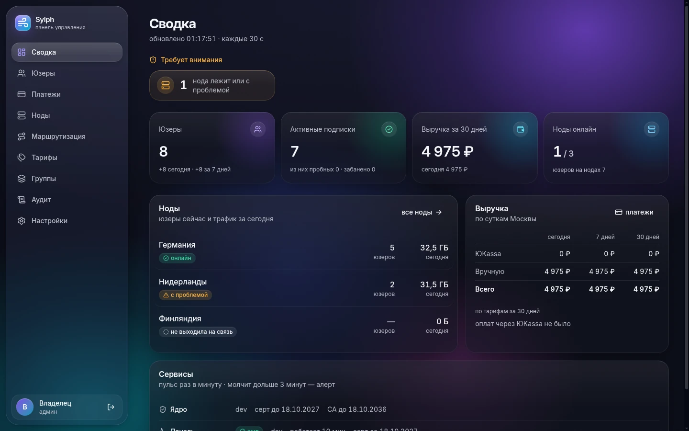
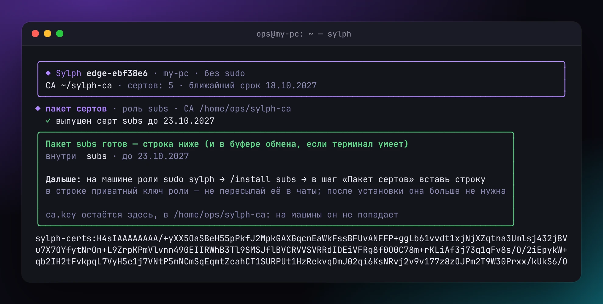
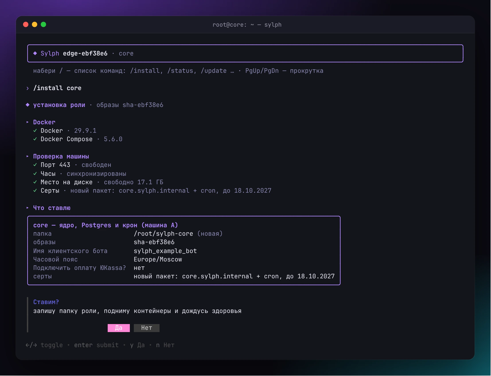
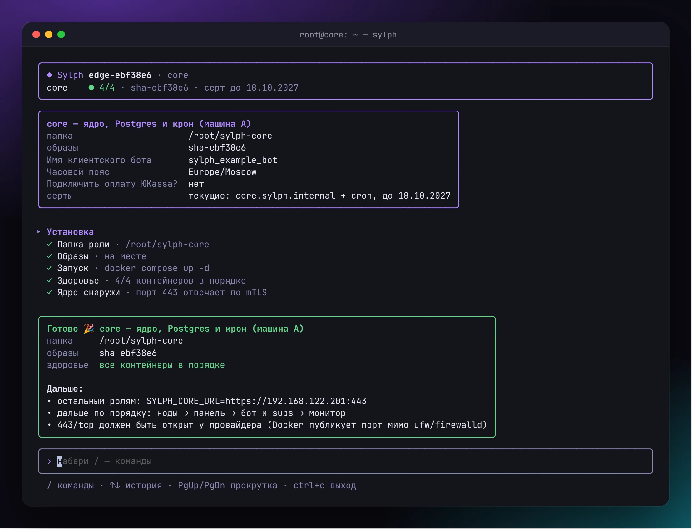
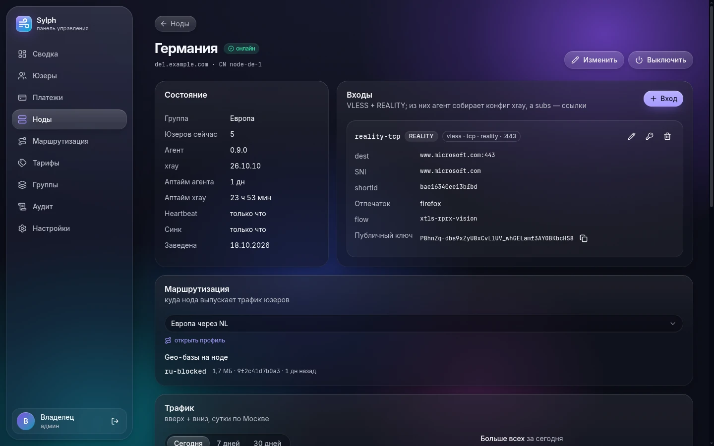
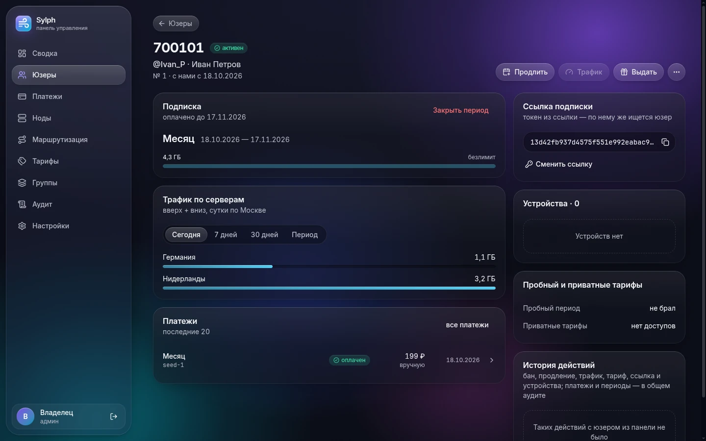
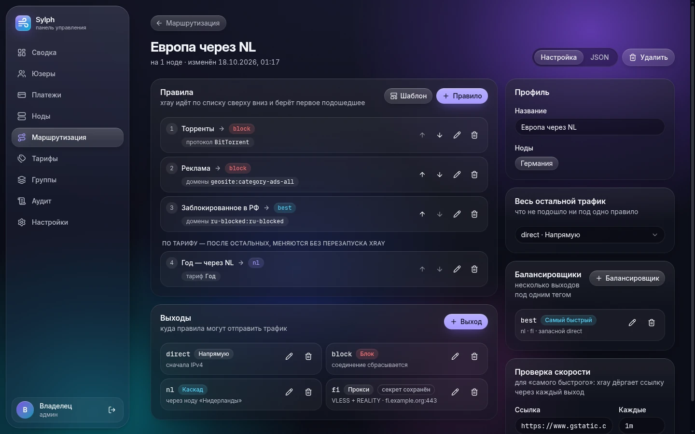
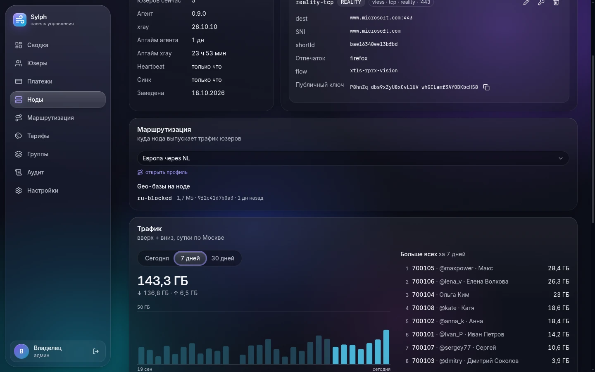
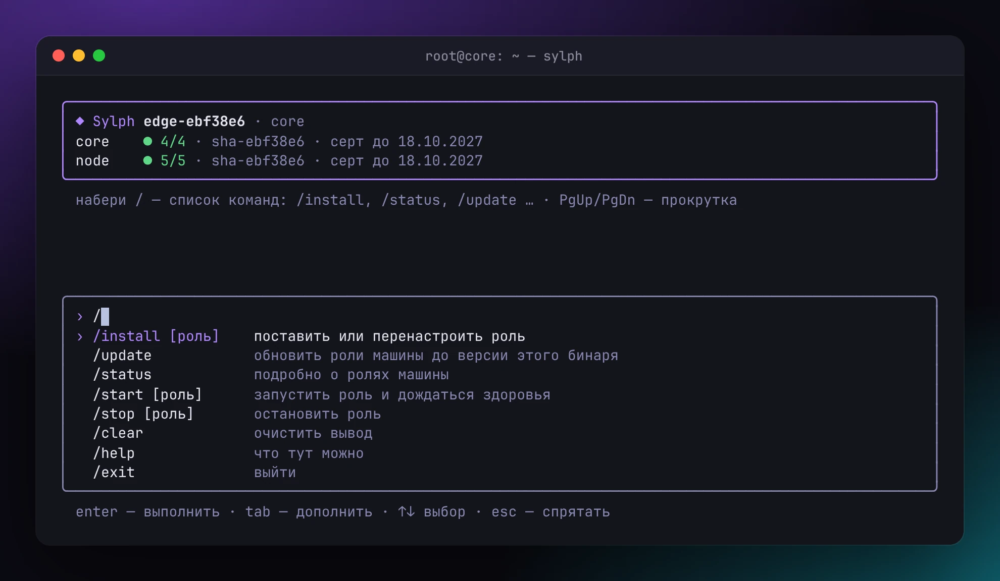
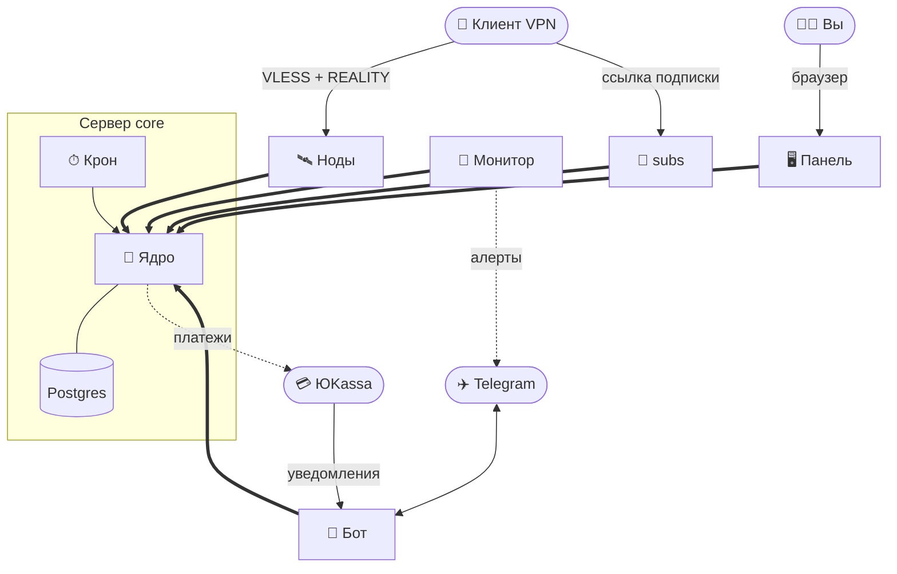

<div align="center">


# Sylph

**Своя VLESS-панель для своего VPN-сервиса**

Ноды на xray с REALITY, Telegram-бот с оплатой через ЮKassa, подписки для клиентов,
веб-панель и алерты в Telegram — на ваших серверах, с установщиком, который всё поставит сам.

[](https://github.com/ITG-Labs/sylph/actions/workflows/ci.yml)
[](https://github.com/ITG-Labs/sylph/releases)
[](LICENSE)

[Установка](#установка) · [Если что-то не так](#если-что-то-не-так) · [Обслуживание](#обслуживание) · [Как это устроено](#как-это-устроено) · [Разработка](#разработка-и-сообщество)



</div>

## Установка

### Что понадобится

**Серверы** — любой Linux на amd64 с Docker Engine и плагином `docker compose` 2.24 или новее.
Проверено на Debian 13 и Ubuntu 24.04. Каждая часть Sylph — своя роль на своём сервере:

| Роль | Что делает | Минимум |
|---|---|---|
| `core` | ядро: база, оплата, всё управление | 2 vCPU · 2 ГБ RAM · 20 ГБ |
| `panel` | веб-панель админа | 1 vCPU · 1 ГБ RAM |
| `bot` | клиентский Telegram-бот и уведомления ЮKassa | 1 vCPU · 1 ГБ RAM |
| `subs` | ссылки подписок для клиентов | 1 vCPU · 1 ГБ RAM |
| `monitor` | бот алертов | 1 vCPU · 1 ГБ RAM |
| `node` | нода, через которую ходит трафик; их может быть сколько угодно | 1 vCPU · 1 ГБ RAM, канал побольше |

**Три домена** с A-записями прямо на свои серверы: панель (например `panel.example.com`), вебхук бота
(`pay.example.com`) и подписки (`sub.example.com`). Сертификаты Let's Encrypt выпустятся сами.

**Два Telegram-бота** от [@BotFather](https://t.me/BotFather) — клиентский и отдельный для алертов, и
ваш Telegram ID (подскажет [@userinfobot](https://t.me/userinfobot)).

**ЮKassa** — по желанию: shop ID и секретный ключ магазина. Без них всё работает, только оплата в боте
выключена, а подписки вы выдаёте из панели.

**Свой компьютер** с Linux или WSL — **не сервер**. На нём будет жить ваш центр сертификации (CA),
которым подписываются серверы. Его ключ никогда не попадает на серверы: так взлом одного сервера не
отдаёт ключи от остальных.

### 1. Подготовьте серверы

На каждом сервере поставьте Docker:

```sh
curl -fsSL https://get.docker.com | sh
```

У провайдера откройте входящие **22/tcp** (SSH) и **443/tcp** — на всех серверах, кроме `monitor`:
ему входящие не нужны. В DNS заведите A-записи доменов панели, бота и подписок на их серверы.
**AAAA не заводите**: IPv6-клиенты придут к сервисам с адреса шлюза Docker.

### 2. Скачайте `sylph`

Один и тот же файл — на каждый сервер и на свой компьютер:

```sh
curl -fLo sylph https://github.com/ITG-Labs/sylph/releases/latest/download/sylph-linux-amd64
chmod +x sylph && sudo mv sylph /usr/local/bin/
```

Версия `sylph` — это и версия сервисов, которые он поставит: всё из одного релиза.

### 3. Создайте сертификаты — на своём компьютере

Запустите `sylph` **без sudo** и наберите `/bundle core`. Первый раз он спросит и создаст ваш CA в
`~/sylph-ca`, а потом напечатает **пакет сертификатов одной строкой** — и положит её в буфер обмена,
если терминал умеет.

<p align="center"></p>

> [!IMPORTANT]
> Сразу сохраните копию `~/sylph-ca/ca.key` в надёжное место. Без неё новые сертификаты не выпустить,
> а утечка этого ключа — это ключи от всего сервиса.

Для остальных ролей пакеты собираются так же, когда до них дойдёт очередь: `/bundle panel`,
`/bundle bot`, `/bundle subs`, `/bundle monitor` и `/bundle node` (спросит имя ноды, например
`node-de-1`). Файлы никуда возить не нужно — строку пакета вы просто вставите в установщик на сервере.

### 4. Поставьте роли — по порядку

На каждом сервере запустите `sudo sylph` и наберите `/install <роль>` (или сразу
`sudo sylph install <роль>`). Установщик задаст вопросы, проверит сервер, покажет сводку и спросит
«Ставим?». Порядок важен: **core → node → panel → subs → bot → monitor**.

<p align="center"></p>

| Роль | Что спросит установщик |
|---|---|
| `core` | ЮKassa (shop ID, секретный ключ, куда вернуть клиента после оплаты) или «нет»; имя клиентского бота без `@`; часовой пояс |
| `node` | адрес ядра; версия xray — оставьте как есть |
| `panel` | домен панели; адрес ядра; сколько часов живёт сессия; имена админов |
| `subs` | домен подписок; адрес ядра; как часто клиенту обновлять подписку |
| `bot` | токен бота; домен вебхука; адрес подписок (`https://sub.example.com`); адрес ядра |
| `monitor` | адрес ядра; токен бота алертов; Telegram ID получателей через запятую; адрес панели |

И везде — пакет сертификатов: вставьте строку, которую напечатал ваш компьютер.

**Адрес ядра** — `https://<IP или домен сервера core>:443`. Установщик покажет его в конце установки
ядра; дальше он одинаковый для всех ролей.

<p align="center"></p>

После установки:

- **panel** — пароль и QR-код для приложения-аутентификатора показываются **один раз**: сохраните
  пароль и отсканируйте QR;
- **bot** — в кабинете ЮKassa укажите URL для уведомлений `https://<домен бота>/yookassa`;
- **monitor** — каждый получатель один раз пишет боту алертов `/start` (иначе Telegram не даст боту
  написать первым).

### 5. Настройте сервис в панели

Откройте `https://<домен панели>` и войдите по имени, паролю и коду из приложения.

1. **Настройки** — название подписки (его видят клиенты в приложении) и ссылка на поддержку.
2. **Ноды → Нода** — `cert_cn` — то имя, которое вы давали в `/bundle node` (например `node-de-1`),
   адрес — IP или домен сервера ноды. Через минуту нода станет «онлайн».
3. **Нода → Вход** — VLESS + REALITY, TCP, порт `443`, SNI — любой крупный сайт с TLS 1.3, например
   `www.microsoft.com`. Ключи панель сгенерирует сама. **Без входа нода не попадёт в подписки.**
4. **Тарифы** — цена, срок, лимит трафика и устройств, при желании — пробный.
5. **Маршрутизация** — по желанию: куда нода выпускает трафик, правила, каскады через другие ноды.
   Назначайте профили, когда ноды уже онлайн.

### 6. Проверьте

- `sudo sylph status` на любом сервере — все контейнеры зелёные, видны сроки сертификатов;
- на сводке в панели блок **«Сервисы»** — все живы;
- бот алертов отвечает на `/status`;
- в клиентском боте `/start` → тариф (или выдайте его себе из панели) → ссылка подписки → добавьте её
  в Happ, v2RayTun или Clash Meta — и подключитесь.

Готово 🎉

### Если что-то не так

| Что видно | Что делать |
|---|---|
| В клиенте «⚠️ Нет доступных серверов» | у ноды нет входа или нода не в группе тарифа: **Ноды → нода → Вход**; если у тарифа задана группа, нода должна быть в ней или без группы |
| Установщик: «ядро не приняло серт» | пакет выпущен другим CA или серт отозван — соберите пакет заново на том компьютере, где живёт ваш CA |
| Установщик: «ядро недоступно» | ядро ещё не поставлено, неверный адрес или у провайдера закрыт 443 на сервере ядра |
| Нет HTTPS у панели, бота или подписок | DNS ещё не разошёлся, у домена есть AAAA или 443 закрыт у провайдера; лог — `docker compose logs caddy` в папке роли |
| Бот молчит или отвечает через раз | этим токеном пользуется ещё кто-то (вторая копия бота) — у одного токена должен быть один бот |
| Контейнер падает по кругу | установщик покажет последние строки его лога; полный — `docker compose logs <сервис>` в папке роли |
| Пароль от панели потерян | `sudo sylph` → `/install panel` → добавить нового админа |

Не нашли свою проблему — спросите в [Discussions](https://github.com/ITG-Labs/sylph/discussions).

### Обслуживание

**Обновление.** Скачайте `sylph` новой версии и на каждом сервере — в том же порядке, `core` первым —
запустите `sudo sylph update`. Он положит свежие файлы, допишет новые параметры, обновит образы и
дождётся здоровья. Откатиться — `sudo sylph update` бинарником прежней версии; миграции базы назад не
откатываются, об этом он предупредит.

**Статус, запуск, остановка.** `sudo sylph status`, `sudo sylph start <роль>`,
`sudo sylph stop <роль>` — или то же через `/status`, `/start`, `/stop` в интерактивном режиме.

**Изменить настройки.** `/install <роль>` на уже стоящей роли подставит текущие значения: можно
поменять настройки, поставить новые сертификаты или добавить админа панели.

**Отозвать сертификат**, если сервер скомпрометирован: на своём компьютере `sylph certs revoke <имя>`,
затем `/bundle core` и на сервере ядра `/install core` с новой строкой — ядро перестанет пускать
отозванный серт.

**Сроки сертификатов.** Сертификаты ролей выпускаются на год; за 30 и за 7 дней до конца монитор
пришлёт алерт.

**Переезд на другой сервер.** Остановите роль (`sudo sylph stop <роль>`), упакуйте её папку **от root с
сохранением владельцев** — `sudo tar -czpf role.tgz sylph-<роль>`, — перенесите, распакуйте так же
(`sudo tar -xzpf role.tgz`) и запустите `sudo sylph start <роль> --dir sylph-<роль>`. Если поменялся
адрес — обновите его: у ноды — в панели, у ядра — у всех ролей через `/install <роль>`.

**Бэкап базы.** Вся база — на сервере ядра. Простой ежедневный дамп:

```sh
cd ~/sylph-core && sudo docker compose exec -T postgres pg_dump -U sylph sylph | gzip > sylph-$(date +%F).sql.gz
```

Храните дампы не на том же сервере.

## Как это устроено

### Что входит

- 🛰 **Ноды** — xray с VLESS + REALITY за Caddy. Агент на ноде сам собирает конфиг xray из настроек
  панели, считает трафик каждого клиента и перезапускает xray, когда конфиг поменялся.
- 🤖 **Telegram-бот** — регистрация, покупка тарифа через ЮKassa, пробный период, статус с трафиком и
  сроком, ссылка подписки, устройства, приватные тарифы по приглашению.
- 🔗 **Подписки** — одна ссылка на клиента: vless-ссылки для Happ, v2RayTun, v2rayN/v2rayNG и других,
  YAML для Clash Meta (mihomo, FlClash, Stash). Лимит устройств по HWID и понятные заглушки «подписка
  истекла» или «закончился трафик» прямо в клиенте.
- 🖥 **Панель** — сводка, клиенты, платежи с перепроверкой в ЮKassa и возвратами, ноды и входы,
  тарифы, группы, маршрутизация (правила, каскады через свои ноды, балансировщики, geo-базы), аудит
  всех действий. Вход по паролю и TOTP.
- 🚨 **Монитор** — бот алертов: 🔴 когда что-то сломалось и 🟢 когда починилось. Ноды, ядро, сервисы,
  зависшие платежи, сроки сертификатов.
- 🧰 **Установщик `sylph`** — ставит, обновляет, запускает и останавливает роли; проверяет сервер и
  ждёт, пока всё станет здоровым.

<table>
<tr>
<td width="50%"></td>
<td width="50%"></td>
</tr>
<tr>
<td width="50%"></td>
<td width="50%"></td>
</tr>
</table>

<p align="center"></p>

### Схема

Каждый сервис — отдельный небольшой бинарник в своём контейнере на своём сервере. В центре — **ядро**:
только оно трогает базу и только оно ходит в ЮKassa. Остальные говорят с ядром по **mTLS**: у каждой
роли свой сертификат от вашего CA, и по нему ядро знает, кто перед ним и что ему можно.



<p align="center"><sub>Жирные стрелки — mTLS: у каждой роли свой сертификат, ядро пускает только своих и знает, кому что можно.</sub></p>

| Роль | Внутри | Наружу |
|---|---|---|
| `core` | ядро, Postgres, крон | 443 — только mTLS |
| `panel` | Caddy → панель | 443 — домен панели |
| `bot` | Caddy → бот | 443 — домен вебхука ЮKassa |
| `subs` | Caddy → подписки | 443 — домен подписок |
| `monitor` | бот алертов | ничего |
| `node` | Caddy, xray, агент | 443 — входы REALITY |

Если ядро недоступно, ноды продолжают пускать клиентов по последнему известному списку, а крон
подхватывает оплаты, даже если уведомление ЮKassa не дошло до бота. Всё, что нужно сохранить, — база,
сертификаты, настройки — лежит в папке роли на диске: переезд сервера — это перенос папки.

### Безопасность

- Сервисы говорят с ядром только по mTLS, у каждой роли свои права, отозванные сертификаты ядро не
  пускает.
- Ключ CA живёт только на вашем компьютере; на серверы уезжает лишь их собственный сертификат.
- Ключи ЮKassa есть только у ядра; токены и пароли — в `.env` с правами 0600; пароли админов —
  только хэшем.
- Контейнеры без лишних прав и с файловой системой только для чтения; на ноде xray и агент работают
  под разными пользователями.
- Caddy не пишет в логи пути и заголовки запросов — токены подписок туда не попадают.

## Разработка и сообщество

- **Как собрать, прогнать тесты и прислать изменения** — [CONTRIBUTING.md](CONTRIBUTING.md).
- **Нашли уязвимость** — сообщите приватно, как описано в [SECURITY.md](SECURITY.md).
- **Вопросы и идеи** — [Discussions](https://github.com/ITG-Labs/sylph/discussions); баги — в
  [issues](https://github.com/ITG-Labs/sylph/issues).
- **Правила общения** — [CODE_OF_CONDUCT.md](CODE_OF_CONDUCT.md).

## Лицензия

[AGPL-3.0](LICENSE) © 2026 ITG-Labs. Sylph можно свободно использовать, менять и запускать на нём свой
сервис, в том числе платный. Если вы меняете код и даёте людям пользоваться изменённой версией —
в том числе по сети, — исходники ваших изменений должны быть открыты под той же лицензией.

Sylph — инструмент. Вы сами отвечаете за то, как его используете, и за соответствие законам своей
страны.
